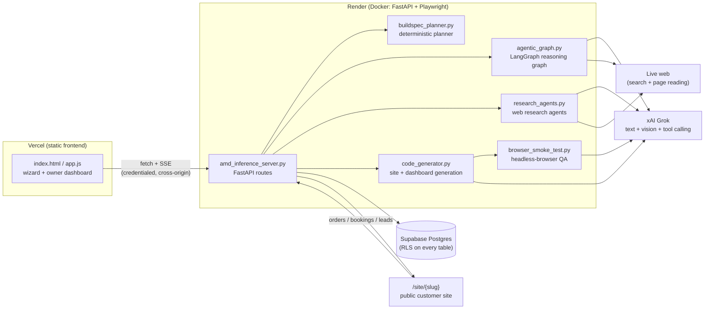
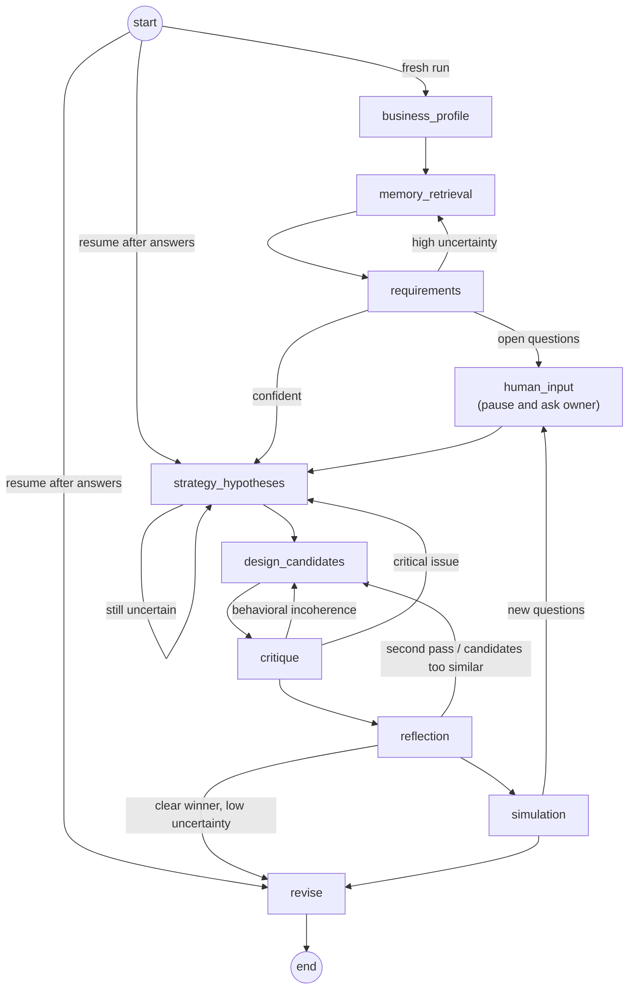

# LaunchFoundry AI

**Describe a business in plain words → get a live website, a working backend, and an owner dashboard for it.**

A business owner types what they do (and can upload photos of a menu, flyer, or storefront). A multi-agent system then:

- researches the business and its local competitors on the live web,
- reasons about what the business actually needs (ordering? bookings? seat selection? quote requests?),
- stops to ask the owner when something important is missing,
- writes a custom website for it, and tests it in a real headless browser,
- connects it to a real database so orders, bookings, and enquiries are saved,
- and generates a back-office dashboard where the owner manages them.

Every site is written from scratch by an LLM. There is no template picker. The system enforces only a small integration contract so that whatever the model writes stays connected to the real backend.

**Live demo:** https://launch-foundary-ai-twrl.vercel.app (sign up with any email to try it)

---

## Contents

- [System overview](#system-overview)
- [From input to live site](#from-input-to-live-site)
- [The reasoning graph (LangGraph)](#the-reasoning-graph-langgraph)
- [Website generation and quality control](#website-generation-and-quality-control)
- [A system that learns from its mistakes](#a-system-that-learns-from-its-mistakes)
- [Data model](#data-model)
- [Deployment and auth](#deployment-and-auth)
- [API reference](#api-reference)
- [Repository layout](#repository-layout)
- [Running locally](#running-locally)
- [Known limitations](#known-limitations)

---

## System overview



There are three separate surfaces:

| Surface | Who uses it | What it is |
|---|---|---|
| **Builder wizard** | Business owner, once | `Intake → Reasoning → Build Spec → Website → QA`. Login required. You can watch the agents work live. |
| **Owner dashboard** | Business owner, ongoing | "My businesses", live site link, preview, the AI-generated admin dashboard, a menu/price editor with photo upload, and a **Request a Fix** box. |
| **Generated site** | The business's customers | Served at `/site/{slug}`. A standalone page that reads live items and saves real submissions. It works without the builder open. |

---

## From input to live site

1. **Intake.** Name, location, goal, free-text description, brand colors, and optional images.
2. **Vision extraction** (`POST /extract-assets`). Uploaded images go to a vision model, which pulls out menu items, prices, services, contact details, and visual cues.
3. **Planning** (`POST /generate-buildspec-stream`, streamed over SSE). Two planners run on the same input:
   - **Deterministic BuildSpec** (`buildspec_planner.py`, no LLM). Classifies the vertical and one of five transaction *shapes* (`storefront_commerce`, `scheduled_booking`, `inquiry_lead`, `portfolio_showcase`, `catalog_reserve`), then picks features from a declarative `FEATURE_REGISTRY` (online ordering, table reservation, appointment booking, patient intake, lead capture, quote request, catalog reservation, portfolio). This sets the site's structure and is predictable and testable.
   - **LangGraph reasoning graph** (`agentic_graph.py`). The LLM-driven layer: business profiling, memory retrieval, requirements, strategy, design candidates, critique, simulation. It can **pause and ask the owner questions**. Its findings feed the generation prompt, and its design decisions (for example colors) override the defaults. [Details below.](#the-reasoning-graph-langgraph)
4. **Research** (`POST /run-research`). Competitor and local-SEO agents use **real tool calling** (`web_search`, `read_page`) against the live web, so the site's copy reflects real findings instead of filler.
5. **Generation** (`POST /generate-code`). One LLM call writes the full customer site, followed by setup of any custom backend it needs, browser testing, automatic repair, and generation of the admin dashboard. [Details below.](#website-generation-and-quality-control)
6. **Critique and deployment package** (`/run-critique`, `/generate-deployment`). Five specialist reviewers (UX, accessibility, conversion, security, performance) score the result. A downloadable self-hosting package (DB schema, docker-compose, auth/payment config notes) is also produced.
7. **Hand-off.** The wizard closes and the owner lands on their dashboard with the live link.

---

## The reasoning graph (LangGraph)

A `StateGraph` over a single Pydantic state (`WebsiteAgentState`, in `agentic_models.py`). It has 10 nodes, conditional routing, and bounded loops.



| Node | What it does | LLM | Tools |
|---|---|:-:|---|
| `business_profile` | Structured profile of the business from raw input and extracted assets | ✓ | |
| `memory_retrieval` | Pulls relevant lessons from a hand-written seed library **plus lessons learned from past generations** (DB-backed) | | |
| `requirements` | Pages, compliance needs, conversion priorities. Raises clarification questions when it finds real gaps, such as items with no price | ✓ | |
| `human_input` | Pauses the run. The server streams the questions and a serialized `resume_state`, and the frontend resumes the graph with the owner's answers | | |
| `strategy_hypotheses` | Competing positioning strategies | ✓ | `web_search`, `read_page` |
| `design_candidates` | Concrete design directions (visual system, primary action, sections) | ✓ | |
| `critique` | Scores each candidate. Behavioral coherence checks (`behavioral_*.py`, `business_archetype_mapper.py`) can force regeneration | ✓ | |
| `reflection` | Decides whether to explore more, skip simulation (clear winner: score ≥ 8, margin ≥ 1.5, low uncertainty), or continue | | |
| `simulation` | Walks a visitor through the chosen design to find friction. Can raise new questions | ✓ | |
| `revise` | Produces the final design spec | ✓ | `web_search`, `read_page` |

**Loop safety:**
- Every loop has a visit cap (requirements ≤ 3, strategy ≤ 3, critique ≤ 4, design revision iterations ≤ 3).
- The streaming runner stops after 60 updates, or when the same state signature repeats 4 times.
- If the graph fails, a fallback execution still returns a usable result, so the owner is never left with nothing.

---

## Website generation and quality control

All of this is in `code_generator.py` and `browser_smoke_test.py`.

**1. Free-form generation with a minimal contract.** The model gets the BuildSpec, the graph's reasoning, research results, and the owner's answers. It has full control over layout, CSS, JS, and copy. The only hard requirements are described in plain language rather than as markup to copy: read live items from `GET /businesses/{id}/items`, and report completed orders, reservations, or leads to `POST /businesses/{id}/submissions`. If generation fails, the owner sees the real reason and a Retry button. No generic template is shown in its place.

**2. Custom backends on demand.** Some businesses don't fit a fixed schema. A cinema, for example, needs showtimes with per-seat availability. For these the model uses **tool calling** (`create_entity_type`, `create_entity`) to set up its own data in a schemaless store (`custom_entities_store.py`). Seat booking is protected by a **Postgres primary-key constraint** rather than check-then-write application logic, so two customers can never claim the same seat (`POST /businesses/{id}/claim` returns `409` on conflict).

**3. Two-tier browser testing on the live page.**
- **Tier 1** (deterministic, free, on by default). Playwright loads the real `/site/{slug}`, clicks into the checkout or reserve flow, and checks that the confirm button is actually visible and not clipped by an `overflow: hidden` parent. This catches a real bug class seen in production.
- **Tier 2** (opt-in, costs LLM calls). An LLM agent gets browser tools (`read_page_state`, `click`, `fill`) and tries to complete the workflow like a real visitor. Every record it creates is tracked by intercepting responses rather than trusting the agent's own report, and is cleaned up afterwards.
- If either tier fails, the page is repaired once automatically and re-tested. The repair can only leave the page as it was or improve it.

**4. AI-generated owner dashboard.** A second LLM call builds a back-office page that fits *this* business, for example "Patient Arrived" status labels for a clinic or a showtime and seat view for a cinema. The model never sees real IDs or URLs. It writes against a small `window.LF` client interface, and the server injects the real client after generation. The page is served only to the business's owner. If generation fails, the dashboard falls back to generic built-in panels.

**5. Request a Fix** (`POST /businesses/{id}/revise`). The owner describes what's wrong. The system first tries a **targeted edit**: the model uses section-level tools (`list_sections`, `read_section`, `write_section`, `add_section`) and touches only what needs to change. If that doesn't pass validation, it falls back to a full rewrite. The live page is replaced **only** if the new version passes the same acceptance check; otherwise the current site stays untouched.

---

## A system that learns from its mistakes

`learned_memory_store.py` records lessons from two sources:

- issues that critique, simulation, and reflection found during real generations,
- and, the strongest signal, **what real owners had to ask "Request a Fix" for**.

On every new run, `memory_retrieval` combines these with the seed library, matched on vertical, subtype, and risk level. A future business similar to one that needed a fix gets warned about it in advance.

---

## Data model

Supabase Postgres, accessed through `psycopg` (`db.py`). Tables are created idempotently on connect, with no ORM and no migrations framework. **Row-Level Security is enabled on every table**: the app connects as the table owner, so Supabase's auto-exposed REST API cannot read password hashes, sessions, or customer data.

| Table | Module | Holds |
|---|---|---|
| `owners`, `sessions` | `auth_store.py` | Accounts (scrypt password hashes) and 30-day session tokens |
| `businesses` | `menu_store.py` | Owner, public `slug`, live site HTML, generated admin HTML, the BuildSpec used (kept as context for revisions) |
| `menu_items`, `business_meta` | `menu_store.py` | Owner-editable catalog, plus a seed guard so regeneration never overwrites the owner's own edits |
| `submissions` | `submissions_store.py` | Real customer orders, reservations, and leads, with status (`new` / `in_progress` / `completed` / `cancelled`) |
| `custom_entities`, `resource_claims` | `custom_entities_store.py` | Model-defined data (such as showtimes) and atomic per-resource claims (such as seats) |
| `learned_memories` | `learned_memory_store.py` | Lessons recorded from critiques and owner fix requests |

---

## Deployment and auth

| Piece | Where | Notes |
|---|---|---|
| Frontend | **Vercel**, static files only | No build step: vanilla HTML/CSS/JS. `.vercelignore` keeps backend source off the CDN. |
| Backend | **Render**, Docker | Built on `mcr.microsoft.com/playwright/python` so Chromium and its OS libraries are available for browser testing. |
| Database | **Supabase** Postgres | `migrate_to_supabase.py` is the one-off SQLite → Postgres migration. |
| Models | **xAI Grok** | A provider layer in `agentic_planner.py` keeps a fast model for structured calls and a stronger "best" model for HTML generation. Pollinations is still supported as an alternative provider. |

**Cross-origin auth.** Because the frontend and backend run on different domains, the session cookie is `HttpOnly; Secure; SameSite=None`. CORS accepts the production Vercel origin plus that project's preview and branch URLs, matched by regex.

The admin dashboard opens as a top-level page on the backend's own domain, where the browser doesn't send that cookie. To handle this:
1. The frontend first gets a **60-second HMAC-signed token** scoped to one business, and the dashboard URL carries that token.
2. When the dashboard loads, the server sets a first-party `lf_admin` cookie (HttpOnly, 8 hours, `Path=/businesses/{id}`). The dashboard's own requests send it automatically, and it is only ever sent for that one business.

**Access rules:**
- Planning, research, and generation endpoints (the ones that trigger paid model calls) require login.
- Owner-only endpoints accept either the session cookie or a valid `lf_admin` cookie. These are editing items, uploading photos, reading or updating customer submissions, Request a Fix, and the admin dashboard.
- If the caller isn't the owner, they get `404` rather than `403`, so business IDs can't be probed.
- `/generate-code` refuses to overwrite a business owned by someone else.
- Only what a customer's browser needs stays public: the site itself, reading the catalog, submitting an order or enquiry, and claiming a seat.

---

## API reference

| Group | Routes |
|---|---|
| Auth | `POST /auth/signup`, `/auth/login`, `/auth/logout` · `GET /auth/me`, `/auth/my-businesses` |
| Planning | `POST /extract-assets` · `POST /generate-buildspec` · `POST /generate-buildspec-stream` (SSE: `buildspec`, `graph_update`, `human_input_required`, `complete`) |
| Generation | `POST /run-research` · `POST /generate-code` · `POST /run-critique` · `POST /generate-deployment` |
| Owner | `POST /businesses/{id}/revise` · `GET`/`PUT /businesses/{id}/items` · `POST /businesses/{id}/items/image` · `GET /businesses/{id}/submissions` · `PATCH /businesses/{id}/submissions/{sid}` · `DELETE /businesses/{id}` · `POST /businesses/{id}/admin-token` · `GET /businesses/{id}/admin` |
| Public site | `GET /site/{slug}` · `POST /businesses/{id}/submissions` · `GET /businesses/{id}/entities/{type}` · `GET …/{entityId}/claims` · `POST /businesses/{id}/claim` |

---

## Repository layout

| Area | Files |
|---|---|
| **API server** | `amd_inference_server.py`: every route, SSE streaming, CORS, auth wiring |
| **Planning** | `buildspec_planner.py` (deterministic BuildSpec) · `agentic_graph.py` (LangGraph graph) · `agentic_models.py` (state and schemas) · `agentic_memory.py` · `agentic_cognition_tools.py` · `cognitive_state_api.py` |
| **Behavioral layer** | `business_archetype_mapper.py`, `behavioral_rulebooks.py`, `behavioral_requirements.py`, `behavioral_planning.py`, `behavioral_blending.py`, `behavioral_validator.py`: map a business to archetypes (such as `fast_impulse_conversion` or `high_trust_consideration`) and check that designs stay consistent with them |
| **LLM and tools** | `agentic_planner.py` (provider layer: JSON, text, vision, tool-calling loops, retries, health) · `agentic_external_tools.py` (web search and page reading) |
| **Agents** | `research_agents.py` · `critique_system.py` · `deployment_system.py` |
| **Generation and QA** | `code_generator.py` · `browser_smoke_test.py` |
| **Persistence** | `db.py` · `auth_store.py` · `menu_store.py` · `submissions_store.py` · `custom_entities_store.py` · `learned_memory_store.py` · `migrate_to_supabase.py` |
| **Frontend** | `index.html` · `app.js` · `styles.css` |
| **Deploy** | `Dockerfile` · `vercel.json` · `.vercelignore` · `.dockerignore` · `.python-version` |

---

## Running locally

Requires Python 3.13 and a Postgres database (a free Supabase project works).

```bash
pip install -r requirements-amd-server.txt
playwright install chromium        # only needed for browser smoke tests
cp .env.example .env               # then fill in the values below
python -m uvicorn amd_inference_server:app --port 8000 --reload
```

Open http://localhost:8000. Locally, the backend serves the frontend itself, so no CORS setup is needed.

| Variable | Required | Purpose |
|---|:-:|---|
| `XAI_API_KEY` | ✓ | xAI key (text, vision, tool calling) |
| `DATABASE_URL` | ✓ | Postgres connection string |
| `FRONTEND_ORIGIN` | for split hosting | Frontend origin (such as the Vercel URL). Turns on cross-origin cookies and CORS |
| `LLM_PROVIDER` | | `xai` (default when a key is present) or `pollinations` (uses `POLLINATIONS_API_KEY`) |
| `XAI_TEXT_MODEL` / `XAI_BEST_MODEL` / `XAI_VISION_MODEL` | | Per-role model overrides |
| `ENABLE_LIVE_WEB_TOOLS` | | Live web search for agents (default on) |
| `ENABLE_SMOKE_TEST_TIER1` / `ENABLE_SMOKE_TEST_TIER2` | | Browser tests (Tier 1 default on, Tier 2 default off) |
| `SMOKE_TEST_BASE_URL` | | Where the browser tests reach the running app (default `http://127.0.0.1:8000`) |

---

## Known limitations

These are known trade-offs and gaps, listed so reviewers don't have to find them:

- **There's no rate limiting.** Public customer endpoints (submitting an order or enquiry, claiming a seat) have no per-IP limits yet.
- **Generation runs inside the HTTP request.** A full generation (model call, browser tests, repair, dashboard) can take minutes. A job queue would be the next step.
- **Uploaded item photos are stored on the container's disk**, so they don't survive a redeploy. They should move to object storage (such as Supabase Storage).
- **The admin-token signing key is per process.** A server restart signs open dashboards out (the owner just reopens the dashboard from the builder), and the key needs to be a shared secret before running more than one instance.
- **The catalog editor saves the whole item list at once**, not per item. That's fine for a single owner, but not for concurrent editors.
- **The deployment package is generated documentation and config.** It isn't executed, and no real payments are processed.
- **There's no automated test suite yet.** Quality checks run at generation time (browser smoke tests and acceptance gates), not in CI.

---

## Project history

This started as an **AMD Developer Cloud / ROCm hackathon** prototype: a single-shot generator using Pollinations.ai for inference (see `amd_gpu_buildspec_starter.ipynb`, `amd_vision_extract.py`, `requirements-amd*.txt`). It has since grown into a full product with accounts, a hosted database, a public site per business, agentic research and planning, browser-tested generation, generated owner dashboards, and a correction loop that feeds learned memory. Names like `amd_inference_server.py` are from that history; inference now runs on hosted xAI models, not local GPUs.
